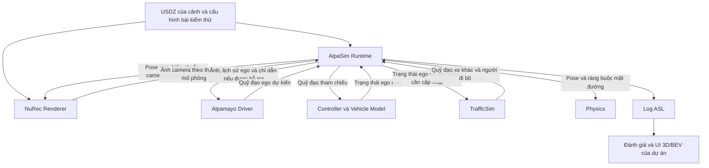

# Phác thảo kiến trúc AlpaSim cho Chuyến lái liên hoàn

[Mở kịch bản 3D hiện tại](http://localhost:8080/viz/?view=3d&scene=continuous-drive)

## Điểm xuất phát

Chuyến lái liên hoàn dài 77 giây. Các tình huống gồm xe chen làn rồi phanh, người chờ qua đường, đèn tín hiệu ở giao lộ và ô tô từ phía sau bật xi nhan, sang phải rồi vượt lên. Bộ lập quỹ đạo dùng trạng thái mô phỏng để phản ứng, nên các mốc trong UI có thể thay đổi theo chế độ Driver. [Cấu hình kịch bản](merge-scenes.js) · [Mô phỏng hiện tại](sim.js)

## Kiến trúc vòng kín



Mỗi chu kỳ lập kế hoạch, Runtime lấy ảnh và lịch sử chuyển động của ego, chuyển chúng cho Driver và nhận quỹ đạo dự kiến. Controller bám quỹ đạo để cập nhật ego. Runtime phối hợp với TrafficSim và Physics để cập nhật cảnh. Ảnh tiếp theo được render từ trạng thái đã thay đổi, nên quyết định vừa rồi ảnh hưởng đến những gì mô hình nhìn thấy ở chu kỳ sau. Sơ đồ thể hiện luồng dữ liệu giữa các khối. [Tutorial AlpaSim](https://github.com/NVlabs/alpasim/blob/main/docs/TUTORIAL.md) · [Quy ước hệ tọa độ AlpaSim](https://github.com/NVlabs/alpasim/blob/main/CONTRIBUTING.md)

| Khối | Vai trò trong Chuyến lái liên hoàn |
| --- | --- |
| **AlpaSim Runtime** | Điều phối đồng hồ mô phỏng, khởi tạo cảnh, gọi các dịch vụ, cập nhật trạng thái và ghi lại từng lượt chạy. |
| **NuRec** | Dùng dữ liệu cảm biến thực để tái dựng cảnh thành tài sản USD. Khi chạy AlpaSim, renderer dùng cảnh USDZ, pose camera và pose các actor có tài sản tương ứng để tạo ảnh từ góc nhìn ego. |
| **Alpamayo Driver** | Dùng chuỗi ảnh camera và lịch sử ego để dự đoán quỹ đạo. Alpamayo 1.5 hỗ trợ thêm chỉ dẫn điều hướng từ tuyến đường. Tuyến mô tả hướng cần đi, còn việc giảm tốc hay chuyển làn thuộc quyết định của policy. |
| **Controller và Vehicle Model** | Bám quỹ đạo Driver đưa ra và tính chuyển động thực tế của ego trong mô phỏng. |
| **TrafficSim** | Cập nhật xe khác và người đi bộ. Có thể phát lại quỹ đạo ghi sẵn để kiểm tra tích hợp. Để người đi bộ đổi ý theo tốc độ và khoảng cách của ego như trong demo, đề xuất triển khai logic riêng qua giao diện TrafficSim và giữ được định danh actor giữa mô phỏng, renderer và log. |
| **Physics** | Ràng buộc pose của ego và các actor theo mặt đường. |
| **Đánh giá và UI của dự án** | Đọc pose, ảnh và dữ liệu lượt chạy từ log. Dùng UI 3D/BEV để xem lại mốc sự kiện, quỹ đạo và kết quả kiểm thử. |

[NuRec](https://developer.nvidia.com/omniverse/nurec) · [Tutorial AlpaSim](https://github.com/NVlabs/alpasim/blob/main/docs/TUTORIAL.md) · [Giao diện TrafficSim](https://github.com/NVlabs/alpasim/blob/main/src/grpc/alpasim_grpc/v0/traffic.proto) · [Định dạng log ASL](https://github.com/NVlabs/alpasim/blob/main/docs/DATA_PIPELINE.md)

## Kết nối với dự án hiện tại

| Vai trò | Khối đang chạy trong bài lab |
| --- | --- |
| Runtime và trạng thái cảnh | `World.step` trong `viz/sim.js` lấy một trạng thái quan sát cho mỗi bước 50 ms, điều phối Driver, Traffic, ghi log, đánh giá và tiến mô phỏng. Các ca chọn trong giao diện và Chuyến lái liên hoàn dùng chung vòng lặp này. |
| Driver và Controller | `egoAction` tính lệnh tăng tốc và đánh lái theo bộ điều khiển được chọn. `advanceEgo` áp dụng lệnh lên mô hình động học xe. Đầu ra quỹ đạo của Alpamayo sẽ đi qua Controller của AlpaSim khi chạy bản NVIDIA. |
| TrafficSim | `updateTraffic` áp dụng luật của từng tác nhân. `advanceTraffic` cập nhật vị trí. Chuyến lái liên hoàn lấy cấu hình tác nhân và mốc từ `merge-scenes.js`. |
| Renderer | `street-view.js` và `bev-view.js` hiển thị lượt chạy từ log. Hàm `rendererFrame(record, frame)` trong `sim.js` trả timestamp theo µs, pose và vận tốc ego, ID và pose các tác nhân trong hệ tọa độ cục bộ của lab. Đây là dữ liệu tham chiếu để xây cầu nối và kiểm tra ánh xạ cảnh, hiệu chuẩn camera và hệ tọa độ trước khi gọi NuRec. |
| Ghi và đánh giá | `writeFrame` ghi trạng thái và lệnh vào log trình duyệt. `evaluateFrame` ghi va chạm, vượt đèn đỏ và rời mặt đường. UI dùng cùng bản ghi cho mũi tên, quyết định và mốc tua. |

Phần huấn luyện và kiểm thử dọc của Python dùng `lab12/planners.py` cho Driver và `lab12/sim.py` cho mô phỏng trên log hoặc lưới ca chen làn. Phần trình duyệt dùng cấu trúc vòng kín ở trên để minh họa thêm chuyển làn và giao thông nhiều tác nhân.

- **Giữ ý đồ kiểm thử từ `merge-scenes.js`.** Tách mỗi tình huống thành một ca có trạng thái ban đầu, làn và điểm kích hoạt, tác nhân, luật phản ứng và tiêu chí đạt. Dùng `sim.js` làm mốc đối chiếu cho hành vi theo luật. Các mốc thời gian của lần chạy JavaScript dùng để tìm sự kiện trên timeline. Với ca phản ứng, điều kiện kích hoạt dựa vào trạng thái tại thời điểm chạy.
- **Chọn cảnh và đối chiếu hình học trước khi chuyển ca.** Dùng một USDZ công khai có đoạn đường hai làn cùng chiều và actor phù hợp với bài thử đầu. Kiểm tra vùng render, trục tọa độ, kích thước và ID actor, hiệu chuẩn camera, đơn vị và timestamp trước khi nối quỹ đạo. Nếu cần đúng bố cục đường hiện tại, phần tái dựng NuRec cần dữ liệu cảm biến phù hợp với cảnh đó. UI Three.js và BEV hiện tại tiếp tục phục vụ việc xem lại từ góc quan sát bên ngoài. [Cảnh công khai AlpaSim](https://github.com/NVlabs/alpasim/tree/main/data/scenes) · [NuRec](https://developer.nvidia.com/omniverse/nurec)
- **Tách dữ liệu đánh giá khỏi đầu vào Driver.** Dùng pose thật, làn và hộp bao của actor để kích hoạt ca và chấm kết quả. Trong bài thử Alpamayo, dùng ảnh camera, lịch sử ego và chỉ dẫn mà cấu hình Driver hỗ trợ. Tránh chuyển ID mục tiêu, mốc sự kiện hoặc lệnh né được tạo sẵn từ demo sang Driver.

## Bước tiếp theo

1. **Chạy một cảnh mẫu chính thức với AlpaSim + NuRec + VaVAM.** Lấy một lượt chạy có ảnh camera, trạng thái actor và `rollout.asl`. Đối chiếu cùng một timestamp giữa ảnh và pose ego. Đây là mốc kiểm tra môi trường và pipeline trước khi đưa Alpamayo vào. [Tutorial Level 1](https://github.com/NVlabs/alpasim/blob/main/docs/TUTORIAL.md#level-1)
2. **Chuyển ca mở đầu “chen phải rồi phanh gấp”.** Ca này chỉ cần một xe gây tình huống và có mốc rõ để đối chiếu. Dùng cùng cảnh, cấu hình và quỹ đạo xe chen để chạy với Driver tham chiếu, sau đó thay bằng Alpamayo. Ghi rõ điều kiện ban đầu, lần chen làn và thời điểm phanh, khoảng hở nhỏ nhất, tốc độ, tiến độ và số va chạm. Với biến thể làn trái trống, ghi riêng kết quả vượt trái rồi về phải. Với biến thể làn trái bị chiếm, đánh giá giảm tốc hoặc dừng an toàn. [Cấu hình Alpamayo trong AlpaSim](https://github.com/NVlabs/alpasim/blob/main/docs/TUTORIAL.md)
3. **Thêm ca người đi bộ quay lại vỉa hè.** Chuyển các trạng thái chờ, bước xuống đường, quay lại và lên vỉa hè vào logic actor. Kiểm tra cả trường hợp làn trái trống và có xe. Đo khoảng hở tối thiểu giữa biên xe và người đi bộ theo thời gian. Hàm `egoMetrics` hiện bỏ qua người đi bộ khi tính khoảng cách dọc và TTC, vì vậy ca này cần phép đo riêng. Khi từng ca đã có điều kiện đạt rõ ràng, ghép lại thành chuyến liên hoàn và chạy với nhiều bộ khoảng cách, tốc độ và thời điểm kích hoạt. [Logic mô phỏng hiện tại](sim.js)

## Chạy và mở kết quả NVIDIA

Trên máy Linux có GPU phù hợp, chuẩn bị một bản checkout AlpaSim theo hướng dẫn chính thức. Bật Docker GPU, lấy dữ liệu cảnh NuRec và quyền truy cập model Alpamayo 1.5 cùng Cosmos Reason2. Chạy bước chuẩn bị môi trường và lấy tài sản VaVAM theo Tutorial. [Onboarding AlpaSim](https://github.com/NVlabs/alpasim/blob/main/docs/ONBOARDING.md) · [Tutorial AlpaSim](https://github.com/NVlabs/alpasim/blob/main/docs/TUTORIAL.md)

Chạy lệnh sau từ thư mục bài lab trên máy GPU. ID trong ví dụ là cảnh mẫu từ Tutorial.

```bash
python3 scripts/run_alpasim_nvidia.py \
  /path/to/alpasim \
  clipgt-02eadd92-02f1-46d8-86fe-a9e338fed0b6 \
  ./nvidia-results
```

Script chạy một lượt VaVAM và một lượt Alpamayo 1.5 trên cùng ID cảnh. Cả hai dùng renderer NuRec mặc định. Lượt Alpamayo xuất thêm video `REASONING_OVERLAY` để xem góc camera, quỹ đạo và phần giải thích do model cung cấp. Lưu lại thư mục `alpasim-…` mà script in ra để xác định kết quả từng Driver. [Đầu ra và cấu hình Driver](https://github.com/NVlabs/alpasim/blob/main/docs/TUTORIAL.md)

Chép video đánh giá MP4 và `aggregate/metrics_results.txt` từ thư mục Driver về máy đang mở lab. Trong **Chuyến lái liên hoàn**, mở **Kết quả Alpamayo + NuRec** ở thanh bên rồi chọn hai tệp. UI đọc tệp trên máy và hiển thị cạnh kết quả của lab. Khi dùng cảnh mẫu, hãy đối chiếu VaVAM với Alpamayo trên cùng ID cảnh. Kết quả JavaScript của Chuyến lái liên hoàn dùng để tham chiếu hành vi và quy trình kiểm thử.
